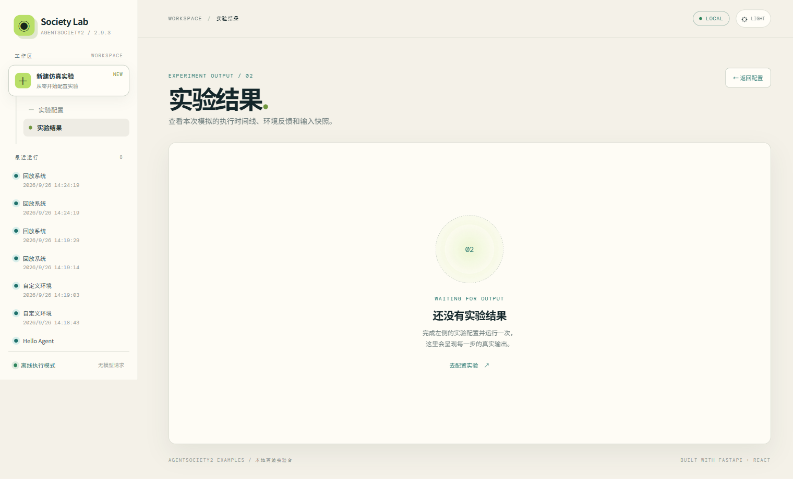

# society-lab · AgentSociety2 博弈实验台

基于 AgentSociety2 2.9.3、FastAPI、React 和 Vite。页面提供三个 [上游 games 示例](https://github.com/tsinghua-fib-lab/AgentSociety/tree/main/packages/agentsociety2/examples/games)的交互式改编：囚徒困境、公共物品博弈和声誉博弈。

## 展示与成功实例



仓库包含 18 个已完成的历史运行，完整索引见 [实例目录](examples/README.md)：

- **6 个真实 LLM 博弈运行**：覆盖囚徒困境、公共物品博弈、声誉博弈，位于 `data/runs/`，包含输入快照、模型决策、结算结果和 ReplayWriter 回放。
- **12 个早期离线示例**：涵盖 hello_agent、custom_env、replay_system，归档于 `examples/offline/`。它们是历史离线验证记录，不代表模型调用成功，也不属于当前页面支持的新建博弈类型。

启动前后端后，在左侧“最近运行”中打开已收录的博弈实例，即可查看结果与输入快照。**查看历史结果无需 API Key，也不会发起模型请求**；新建运行需要配置自己的模型连接。历史记录使用 `gpt-5.6-luna`，新运行请填写自己服务支持的模型。

另一张界面截图：[调试后界面](society-lab-after-fix.png)。截图为历史界面记录，以当前源码为准。

## 启动

公开只读展示站：[society-lab.wei67.top](https://society-lab.wei67.top)。展示站可查看全部 18 个成功实例，模型配置与新建实验已关闭。部署方式见 [VPS 部署说明](deploy/README.md)。下面的启动方式保留本地完整交互功能。

需要 Python 3.12、uv、Node.js 20.19+。

```bash
uv sync --frozen
uv run uvicorn backend.app:app --host 127.0.0.1 --port 8000
```

另开终端：

```bash
cd frontend
npm ci
npm run dev
```

打开 http://127.0.0.1:5173。API 文档位于 http://127.0.0.1:8000/docs。

构建前端：

```bash
cd frontend
npm run build
```

`frontend/dist/` 为生成文件；上面的开发启动方式已配置 `/api` 代理。生产部署需另外配置前端静态文件服务与 API 反向代理。

## 模型配置与运行

在“ENV 配置”填写 `AGENTSOCIETY_LLM_API_KEY`、`AGENTSOCIETY_LLM_API_BASE` 和 `AGENTSOCIETY_LLM_MODEL`，或者复制 `.env.example` 为 `.env` 后填写。每次运行都会读取当前配置，并通过 AgentSociety2 的 `LLMClient` 请求模型。密钥不会返回浏览器，也不会写入运行结果。

| 示例 | 决策与环境 |
| --- | --- |
| 囚徒困境 | 两个 Agent 分别选择合作或背叛；提交给 `PrisonersDilemmaEnv`，读取收益结果。 |
| 公共物品博弈 | 每轮各 Agent 决定出资额；`PublicGoodsEnv` 计算公共收益和个人收益。 |
| 声誉博弈 | 各 Agent 根据接收者声誉决定捐赠；`ReputationGameEnv` 更新声誉和收益，汇总统计。 |

启用的 Agent Skill 会保存在本次运行的 `skills/<name>/SKILL.md`，并加入该 Agent 决策的系统提示词。每次运行在 `data/runs/<id>/result.json` 保存输入、模型决策和结算事件；`replay/` 下保存 ReplayWriter 事件。模型请求失败或响应格式无效时，该运行标记为失败，不会伪造决策。

上游示例使用 `AgentSociety.ask` 或 `LLMDonorAgent`。这里按 2.9.3 的已安装接口调用相同博弈环境，由 `LLMClient` 生成各 Agent 决策，适配本地 Web 表单。声誉示例的接收者按轮次轮换。

## 仓库内容

`backend/` 为 API 和运行逻辑，`frontend/` 为交互界面，`uv.lock` 与 `frontend/package-lock.json` 用于锁定依赖。仓库收录上述已完成实例，未收录本机 `.env`、虚拟环境、依赖目录、缓存及失败调试日志。新增运行默认被 Git 忽略，确认适合公开后再将对应目录加入 `.gitignore` 的展示白名单。
